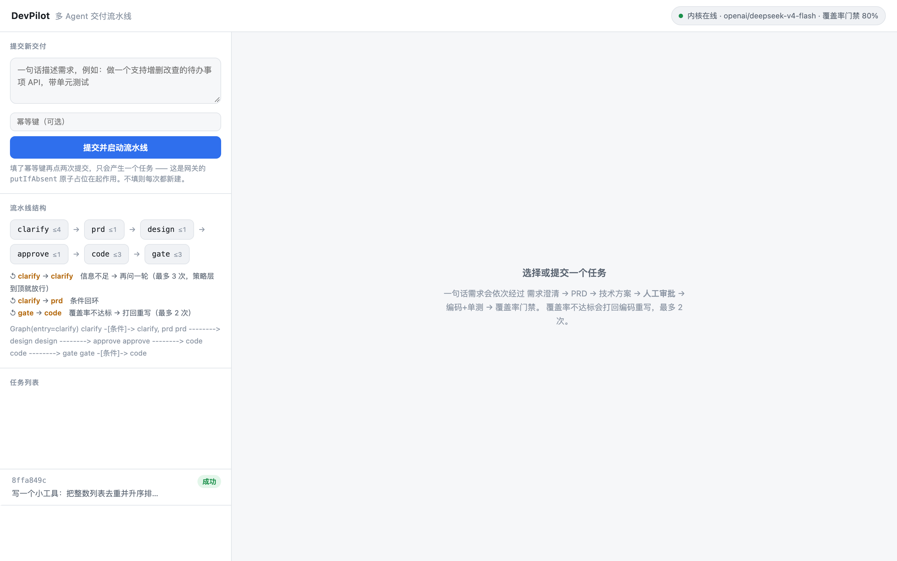
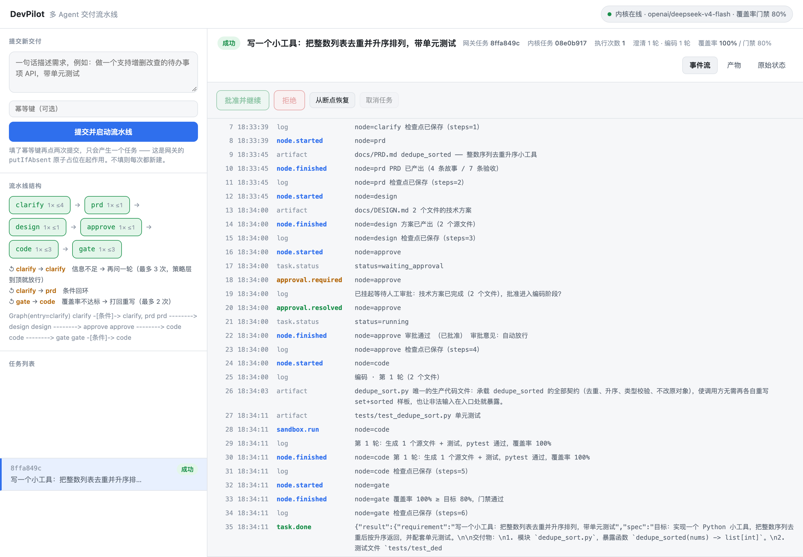

# DevPilot · 多 Agent 交付流水线

> 一句话需求 → 需求澄清 → PRD → 技术方案 → **人工审批** → 编码 + 单测 → 覆盖率门禁
>
> 覆盖率不达标会**打回编码重写**，最多 2 次；打回次数用尽则任务失败。

DevPilot 与 [CitePilot](../CitePilot) 互补：CitePilot 打「单 Agent + 检索质量」，
DevPilot 打「多 Agent + 工程约束」—— 编排、状态机、幂等、沙箱、断点恢复、超时重派。

| | CitePilot | DevPilot |
|---|---|---|
| 核心问题 | 答案**对不对**、引用可不可信 | 流程**会不会失控**、任务**会不会丢** |
| Agent 形态 | 单 Agent 主循环 | 6 节点图 + 2 条条件回环 |
| 关键机制 | 双路召回 + RRF、引用深链 | 状态机、检查点、幂等、租约、沙箱 |
| 对应实践 |  Q1–Q7、Q12–Q14 |  Q8–Q11、Q15； Q2/Q4/Q9/Q14 |

---

## 1. 架构

```
   浏览器（演示看板）            命令行（devpilot cli）
        │                            │
        └────────────┬───────────────┘
                     │ /api/**   ← 对外接口：将来在这里做鉴权、限流、多租户
                     ▼
        ┌──────────────────────────┐
        │  Java 网关  :8091         │  控制面
        │  任务表 · 状态机 · 幂等    │
        │  租约 · 超时重派 · 审计    │
        └────────────┬─────────────┘
                     │ /v1/** + X-Internal-Token   ← 内网接口
                     ▼
        ┌──────────────────────────┐
        │  Python 内核  :8078       │  执行面
        │  编排引擎 · Agent 节点     │
        │  沙箱 · 检查点 · 事件总线  │
        └──────────────────────────┘
```

**为什么是两层，而不是 Python 一个人全干了。**
两者的失败模式与生命周期完全不同。内核是重活（跑模型、起子进程、等审批），
它必然会重启、会 OOM、会被升级；网关是轻活（内存表 + 定时扫描），它可以一直活着。
**把任务账本放在"更可能一直活着"的那一侧，超时重派才有意义** ——
否则收尸的人自己也死了，谁来收尸。

| 层 | 技术 | 说明 |
|---|---|---|
| 内核 | Python 3.13 / FastAPI / SQLite(WAL) / litellm | 同步阻塞的工作线程，一条任务一个线程 |
| 网关 | Java 21 / Spring Boot 3.3.5 **WebFlux** | 选 WebFlux 只为 SSE：一次交付几分钟，MVC 的 SseEmitter 一个连接占一个线程，几百并发就把线程池打满 |
| 通信 | HTTP + SSE（`event:` 行 + 单调 `seq`） | 事件类型是**有限枚举**，界面可以穷举处理 |
| 模型 | DeepSeek（`openai/deepseek-v4-flash`） | 换模型只改 `OHOPILOT_MODEL` 一类环境变量 |

---

## 2. 快速开始

```bash
# 1) 配置：把 DeepSeek key 写进 .env（DEVPILOT_API_KEY）
cp .env.example .env

# 2) 起双服务（内核 + 网关，Ctrl-C 一起停）
./scripts/dev.sh

# 3) 打开演示看板
open http://127.0.0.1:8091/
```

命令行方式：

```bash
./.venv/bin/devpilot run "写一个小工具：把整数列表去重并升序排列，带单元测试"
./.venv/bin/devpilot ls
./.venv/bin/devpilot show <task_id>
./.venv/bin/devpilot pipeline        # 打印流水线结构
```

测试：

```bash
.venv/bin/python -m pytest -q              # 内核 146 个测试，约 6 秒
cd gateway && mvn -B test                 # 网关 69 个测试
./scripts/build.sh                        # 打包网关 jar（**skipTests**，只打包）
```

> 注意顺序：`dev.sh` 跑的是**打包好的 jar**，不是源码。
> 改了 Java 代码或演示页之后必须重新 `./scripts/build.sh`，
> 否则你会对着旧代码调试 —— 表现是"明明改对了却没生效"。

---

## 3. 流水线

```
                 ┌──── 信息不足（≤3 轮）────┐
                 ↓                          │
  [clarify] ──条件──> [prd] → [design] → [approve] → [code] → [gate]
                                                           │   ▲
                                                           └───┘
                                                       覆盖率不达标（≤2 次）
```

| 节点 | 职责 | 关键点 |
|---|---|---|
| `clarify` | 需求澄清 | 判断标准是「工程师能否不问问题就开工」；达上限**主动放行**而不是死等 |
| `prd` | 产出 PRD | JSON 喂下游、Markdown 给人看 —— 同一份数据两种视图 |
| `design` | 技术方案 | **收敛上下文防污染**：Agent 之间传契约，不传对话 |
| `approve` | 人工审批（HITL） | 阻塞在 `threading.Event` 上；超时按拒绝处理 |
| `code` | 编码 + 单测 | 沙箱内写文件并**真的跑 pytest**；带上一轮失败反馈 |
| `gate` | 覆盖率门禁 | 「测试没跑起来」≠「覆盖率 0」，这是两种不同的失败 |

**固定边 vs 条件边。** 固定边构成无环 DAG，成环即定义错误；
条件边**故意允许成环**（澄清追问、覆盖率打回）。区分它们不是咬文嚼字：
一个分叉表示「多个后继都执行」，一个条件边表示「只选一个」，语义正好相反。

**两层刹车。**

| 层 | 在哪 | 管什么 |
|---|---|---|
| 策略层 | 节点内部 | 达到轮次上限就**主动放行**，不死等 |
| 保护层 | 图定义 `max_visits` | 就算策略层写错，也不许超过 N 次 |

> 实测踩坑：编码回环是 `code → gate → code`，**gate 也在环上**。
> 只给 `code` 放宽预算，第一轮打回后 `gate` 第 2 次被调度就撞上默认上限 1，
> 整个任务以 `NodeBudgetExceeded` 失败 —— 而报错信息说「router 没能收敛」，
> 把排查方向带向完全正常的 router。刹车必须配在**回环上的每一个节点**。

---

## 4. 核心设计决策（对着实践题讲）

### 4.1 显式状态机 > 布尔字段（ Q2）

三个布尔量有 8 种组合，其中 5 种自相矛盾（`isRunning && isDone` 是什么？），
而代码里没有任何东西阻止并发把它写出来。
显式状态机把「状态是有限枚举、转移是显式的表、非法转移直接抛异常」三件事一次解决。

```
PENDING → DISPATCHED → RUNNING → {SUCCEEDED | FAILED | CANCELLED}
              ↑            │
              │            ├→ WAITING_APPROVAL → RUNNING（放行）
              └── TIMEOUT ←┘                └→ FAILED / CANCELLED
```

三条刻意的不允许：
- `WAITING_APPROVAL → SUCCEEDED`：审批还没给结果就报成功，等于把人当摆设
- `PENDING → RUNNING`：没派发就执行，是幽灵任务
- 终态没有出边：想重跑就**新建任务**，历史只追加，事后审计能还原真相

**为什么控制面和执行面用两套校验强度。**
网关自己的动作（取消、派发、重派）用严格表 —— 非法就是 bug，要立刻炸出来。
但内核是靠异步事件流说话的，这条流可能断、可能丢，
网关**无法保证观察到每一个中间态**。对上报也用严格表，
后果是一条合法的「从 DISPATCHED 直接到 SUCCEEDED」回报被当成过期丢弃，
任务变成僵尸。所以执行面上报用更宽的规则，边界只有两条：
终态不可改写、没派发过不接受执行结果。

### 4.2 幂等：`putIfAbsent`，不是 check-then-act（ Q9）

```java
TaskRecord existing = byIdemKey.putIfAbsent(idemKey, fresh);
if (existing != null) { return new SubmitOutcome(existing, true); }
```

「先 get 判空再 put」是典型竞态：两个请求同时 get 都拿到 null，然后都 put，
同一个幂等键产生两个任务。`putIfAbsent` 把检查+写入合成一个原子操作。

**幂等键贯穿全链路。** 网关用**自己的任务 id** 当内核的幂等键 ——
两边用不同的键，「网关重试一次派发」在内核眼里就是两个不同请求，
内核会老老实实跑两遍，钱翻倍。用同一个键之后：
网关重试 → 内核幂等命中 → 返回原任务，整条链上「同一个逻辑任务」只有一个标识。

**诚实说明：这套实现在多副本下失效。**
内存 Map 只在单实例成立，网关部署两个副本时 A 的 putIfAbsent 对 B 不可见。
生产做法是换成带唯一索引的数据库，让唯一性由存储层保证。
评审要讲清的是**机制**（原子占位、状态机、租约），换 DB 只是换了执行者。

### 4.3 租约 + 超时重派（ Q4）

派发时写一个租约到期时间；Reaper 定时扫描过期任务，决定重派还是判死。

为什么需要它：任务有四种结束方式 —— 成功、失败、取消、**执行者消失**。
前三种都会产生事件，第四种**什么都不会发生**。内核被 kill、机器断电、网络分区，
事件流只是静静地断了。不做任何事，这个任务就永远停在 RUNNING。
这就是「漏」。

检测沉默的失败者只有心跳和租约两种手段。**心跳在这里是循环论证**：
心跳需要执行者定期上报，而执行者崩了就不会上报 —— 崩恰恰是我们要检测的情况。
所以用租约。

一对必须讲清的权衡：

| | 后果 |
|---|---|
| 租约太短 | 正常的慢任务被误判失联 → 重复执行（烧钱） |
| 租约太长 | 真的失联后要等很久才重派（任务卡住） |

三个容易漏掉的点：
- **等审批的任务也要有租约**（对齐内核的审批超时 1800s + 余量）。
  直接清空租约的话，内核在等人期间挂掉，这个任务就再也没人管 ——
  界面上显示「等待审批」，用户点了按钮却报错，因为对面根本没人还在等。
- **续租长度要跟状态走**。等审批时用 30 分钟的租约；
  如果心跳一律续 10 分钟，内核在等人期间吐一条 log 事件就把租约缩短了，
  20 分钟后把还在等人的任务重派掉。
- **重派前先对账**。先问一句内核「它是不是其实已经跑完了」——
  回执丢包比想象中常见，不查就重派等于白跑一遍。
- 重派分两段：优先走 `/resume`（断点恢复，内核重启后唯一能真正续跑的方式），
  失败再退回重新提交（同一幂等键）。

### 4.4 沙箱：四件事缺一不可（ Q11）

| 防护 | 做法 | 漏掉的后果 |
|---|---|---|
| 路径越界 | `resolve()` 后做前缀比对 | `../` 读到工作区外任意文件 |
| 命令白名单 | 只允许固定几个，**不含 shell** | 一条 `rm -rf` |
| 环境变量白名单 | 只注入 PATH/HOME 等少数几个 | API key 泄进子进程、再被写进模型输出 |
| 子进程超时 | `start_new_session=True` + `os.killpg` 整组杀 | 挂死的 pytest 占住线程 |

为什么环境变量用**白名单**而不是黑名单：黑名单永远在追新
（今天防 `API_KEY`，明天模型输出里出现的是 `DEEPSEEK_TOKEN`）。
白名单默认拒绝，新变量不出现除非你显式放行。

### 4.5 断点恢复：恢复的是**状态**，不只是进度（ Q9）

每节点执行完落一个检查点（node + visits + steps + state）。
`visits` 必须存 —— 否则恢复后刹车计数器从 0 开始，保护层失效。

恢复点是「上次完成节点的**下一个**」，不是它自己：直接从上次的节点重跑会重复执行，
在那个节点是编码（很贵）的时候就是实打实的重复花钱。

> 实测踩坑（最有价值的一个）：从 `approve` 恢复时 `design` 不重跑，
> 但 `ctx.get("design")` 是 None → 生成空测试 → pytest "no tests ran"
> → 门禁不通过 → 回环撞刹车。**全程没有一个异常，只有一堆看似合理的日志。**
> 根因是共享状态没从检查点恢复。这类「不报错但结果错」的问题最贵，
> 所以把约束写进代码（`restore_from_checkpoint`），而不是写进注释。

### 4.6 事件协议与 SSE 中继（ Q15）

- 事件类型是**有限枚举**，不是自由文本 —— 新增一种必须显式加常量，拼写错误挡在编译期
- 每条带单调 `seq` + `task_id` —— 断线重连 `?since=N`，不丢不重
- 内核先回放**持久化**事件再追实时 —— 内核重启后客户端仍能拿到完整历史
- 终态事件到达时**主动关闭** SSE —— 不关的话浏览器一直挂着死连接，这是 SSE 最经典的坑
- 心跳每 20 秒一次 —— 任务卡在审批点几十分钟，一条数据事件都没有，
  中间设备会把「长时间没字节流动」的连接当死连接掐掉

> 实测踩坑（三个都真实发生过）：
> ① 给流加 `.timeout(30s, Flux.never())` 当「别无限等」的兜底 ——
>    结果 30 秒没事件就切到 `never()`：**既不报错也不结束，只是永远不再出声**。
>    而流水线两次模型调用之间完全可能静默超过 30 秒。
>    正确做法是真重连（指数退避 + 游标续传），上限交给租约兜底。
> ② Spring 的 SSE 解码器会把 `event:`/`data:` 外壳**剥掉**再给你 String ——
>    自己再按行找 `data:` 前缀，一条都匹配不上，且不报任何错。
> ③ 对 `text/event-stream` 端点返回 `Flux<String>` 时，Spring 会把你手工拼的
>    SSE 帧再包一层 `data:`，前端收到转义乱码。应该用 `ServerSentEvent`。

### 4.7 harness 第 4 层：验证（ Q14）

每个节点出口做 Schema 校验，不合格把**具体错误**回灌重试。
只说「请重新输出」没用，模型会原样再错一遍；
说「缺少字段 test_plan、files 应为数组而不是字符串」，它才可能改对。

无歧义的错误就地修正，不重试：模型把单元素数组写成裸值（`"files": "a.py"`），
语义毫无歧义，顺手 `as_list()` 修掉比重试便宜。

### 4.8 输出截断：一类不会报错的错误（本次实测新增）

模型输出被 `max_tokens` 截断**不会抛异常**。内容为空时还能一眼看出来；
难查的是「写了一半就断」—— 它看起来像一份正常回答，直到下游解析 JSON 才炸，
而那时错误信息已经指不出原因了。

实测案例：`design` 节点默认 2000 tokens，产出十几个文件的方案必然截断，
于是连续三次「输出不合规」，最后**静默降级成最小骨架**，
整条流水线依然报告成功，交付物质量掉了，日志里没有一处说这里出过问题。

修法（三层）：
1. 判据用 `finish_reason == "length"`，与内容是否为空无关；一旦截断就**放大预算重来**
2. 顶格预算仍截断时，抛 `OutputTruncated`（区别于 `LLMError`）——
   两种情况的处置完全相反：格式不对 → 回灌重试有意义；截断 → 重试只会重复截断
3. `call_json` 遇到截断**立刻放弃重试**，把准确原因冒到最上面

### 4.9 成本记账到节点（ Q9）

```
total:  calls=14  out=32802
by_node: clarify=(1,1172)  prd=(1,1200)  design=(1,3554)
         code=(7,14817)  code_tests=(4,12059)
```

「这次任务花了多少钱」不是有用的问题，「钱花在哪个节点」才是。
实测编码节点是澄清节点的 10 倍以上，只报总数会让优化完全失去方向。

### 4.10 关键路径（ Q14 手撕题）

`plan.py` 独立实现：拓扑排序（确定性）、找环、**带权最长路**、有限并行度调度。
总工期由最长链决定，优化非关键路径节点没有收益 ——
所以 `_collect()` 会算出 `critical_path` 和 `makespan`，告诉你要优化哪里。

为什么独立成 `plan.py` 而不是塞进 `graph.py`：
DAG 静态分析（分叉 = 多后继都执行）和流水线执行（条件边 = 只选一个）语义相反，
混在一起会互相牵制。

### 4.11 输出净化：模型漏出的闭合标签（本次实测新增）

模型偶尔会在正文末尾凭空多输出一行 `</output>`（它输出协议里的闭合标记泄漏了）。
这一行会被原样写进 `.py`，然后在 pytest **收集阶段**炸成 `SyntaxError` ——
报错行指向被污染的那一行，指不出根因。

危害不止"少一个文件"，而是一条完整的静默失败链：

```
标签写进文件 → pytest 收集失败 → 门禁误判为「测试不通过」
            → 反馈信息只有「覆盖率未解析到」（无用） → 编码节点重生成、
              撞同一个坑 → 三轮刹车用尽 → 接受一份根本跑不起来的交付
            → 流水线仍报 succeeded
```

它最坏的地方是**遮蔽真实问题**。手动清掉那行标签后重跑同一个沙箱：
收集通过、覆盖率 100%，只剩 **1 个真实失败**（`column_stats` 对空列没返回
`stddev` 键）。也就是说，模型本来有机会在第二轮修掉这个真 bug ——
是 harness 的脏输出让它连"哪里错了"都看不到。

修法与围栏一致（语义零歧义 → 就地修正）：
**先清包裹标签行、再剥 Markdown 围栏**，顺序不能反 ——
`<output>```py ... ```</output>` 这种叠加形态，先剥围栏会因标签挂在末尾而匹配不上。

> 补测试时发现一个配套问题：项目根 `pyproject.toml` 没有配 `testpaths`，
> `pytest` 会递归进 `var/workspaces/`，把**沙箱里被生成到一半的半成品**
> 当成自己的测试来收集。表现是"我们的测试挂了"，实际和我们无关。
> 已加 `testpaths` + `norecursedirs`。

**这一节真正想说的是**：这类 bug 单测全绿时完全不可见 ——
只有端到端真跑才暴露得出来。所以流水线的验证层必须**真跑**，不是看起来在跑。

### 4.12 能确定的事不要问模型（本次实测新增）

同一类问题在端到端里又出现两次，都记在日志里：

```
生成 tests/__init__.py 降级：输出被截断（已输出 16000 tokens）…
```

为一个**空的标记文件**烧掉一次调用、还循环输出到 16000 tokens 才被截断。
顺着这条线还挖出另一处：`test_file` 原来是「取 `tests/` 下的第一个」，
而方案里第一个恰好是 `tests/__init__.py` —— 于是

- 测试的提示词把断言写进了 `tests/__init__.py`；
- 真正的 `tests/test_xxx.py` 反而走了「实现一个文件」的提示词
  （它要的是实现，不是断言），两份内容互相打架；
- 覆盖率因此莫名其妙上不去，而报错信息只会说「测试未通过」。

四处修正，都在同一条原则上：

| 位置 | 原来怎么做的 | 改成 |
|---|---|---|
| 挑测试文件 | 取 `tests/` 下第一个 | 优先 `test_*.py` / `*_test.py`；退到非 `__init__.py`；再退默认名 |
| `tests/__init__.py` | 交给模型生成 | **直接写死**，一次调用都不花 |
| 测试文件 | 「实现文件」提示词也生成一遍 | 跳过，只由「测试工程师」提示词生成 |
| 测试提示词 | 「用 `from app.main import xxx` 这种绝对导入」 | 直接列出**真实的模块名** |

最后一条是实测出来的：第 1 轮最常挂在导入上 —— 模型照着示例猜了一个
项目里根本不存在的 `app` 包。把 `from src.dedupe_sorted import ...` 这种
**准确**的导入摆到它面前，这类失败就消失了。
提示词里少一点需要模型推理的地方，就少一类失败。

这条原则在本项目里出现了四次：剥 Markdown 围栏、清模型漏出的闭合标签、
`as_list()` 就地修正裸值、以及这里的标记文件 ——
**同一个道理：语义零歧义的事就地做掉，不重试、不问模型。**

### 4.13 迟到的订阅者拿不到历史（网关侧，本次实测新增）

截图时发现的：任务明明已完成，详情页的事件流面板却显示「等待事件…」。

原因一句话就能说清 —— 终态时把 sink 槽位**整个删了**，
于是迟到的订阅者触发 `computeIfAbsent` **新建一个空槽**，
replay 回放的是那个空槽，而不是内存里的 `history` 列表。
两个数据结构各管一摊，谁也没想到对方。

修法：`stream()` 先判断终态 —— 终态任务直接回放 `history` 然后结束；
非终态则「先补历史、再接直播」，用 `distinct(seq)` 去掉两段之间的重叠。

**这一节真正想说的是**：回放是给迟到者用的。
设计回放语义时，最该测的是「事后才来的人」，而不是「一直在场的人」——
后者永远不会暴露这类问题，因为 replay 对他们来说天然是满的。

---

## 5. 实测记录（真实模型，DeepSeek deepseek-v4-flash）

需求：`写一个小工具：把整数列表去重并升序排列，带单元测试`

同一句需求，harness 修复前后各跑了一次 —— 差别不是"稍微好一点"，是一个量级：

| 指标 | harness 修复前 | 修复后 |
|---|---|---|
| 最终状态 | `succeeded` 但**测试未通过**（门禁降级接受） | `succeeded`，测试通过 |
| 覆盖率 | 93% / 门禁 80%（**作废**，因为有失败用例） | **100%** / 门禁 80% |
| 编码轮数 | 3 轮（刹车上限，全部撞完） | **1 轮** |
| 全程耗时 | ~10 分钟 | **67 秒** |
| 降级标记 | `gate_degraded=True` + `degraded=True` | 全部 False |
| 模型侧异常 | 多次输出截断（16000 tokens 顶格） | 无 |

修复前那轮的价值在于它**暴露了三个真 bug**（见 4.11 / 4.12），
并且验证了门禁最关键的一条判定：**覆盖率 93% 已达标、但测试没通过 → 不能算合格**。
它按设计降级接受，并且把原因写进了账本：

```
gate_degraded: True
gate_reason:   测试未通过（存在失败的用例），已降级接受
```

修复后这轮是正常路径的完整闭环：

| 指标 | 值 |
|---|---|
| 节点访问 | `clarify:1 prd:1 design:1 approve:1 code:1 gate:1` |
| 事件链 | `approval.required` → 人工放行 → `approval.resolved` → 编码 → 门禁通过 → `task.done` |
| 产物 | `unique_sort.py` `tests/test_dedupe_sort.py` `docs/PRD.md` `docs/DESIGN.md` `conftest.py` |





---

## 6. 目录结构

```
DevPilot/
├── src/devpilot/
│   ├── config.py            配置：只从环境变量与 .env 读，不硬编码密钥
│   ├── events.py            事件协议：有限枚举 + 单调 seq + 回放/实时
│   ├── llm.py               统一模型出口：分类重试 + 预算翻倍 + 按节点记账
│   ├── graph.py             编排引擎：固定边/条件边/刹车/拓扑/找环
│   ├── plan.py              DAG 静态分析：关键路径、有限并行度调度
│   ├── state.py             状态机 + 任务表 + 检查点（SQLite WAL）
│   ├── sandbox.py           沙箱：路径/命令/环境变量白名单 + 超时强杀 + 回滚
│   ├── runtime.py           RunContext + ApprovalGate（HITL）
│   ├── pipeline.py          装配 6 节点 + 断点恢复
│   ├── fsutil.py            ensure_dir：绕开环境对 mkdir 的 shim 干扰
│   ├── server.py            内核 HTTP + SSE
│   ├── cli.py               命令行客户端
│   └── agents/              6 个节点（clarify/prd/design/approve/code/gate）
├── gateway/                 Java 网关
│   └── src/main/java/com/devpilot/gateway/
│       ├── model/           TaskState（转移表）、TaskRecord
│       ├── service/         TaskStore、KernelClient、TaskDispatcher、Reaper、AuditLog
│       ├── controller/      TaskController、MetaController、统一异常映射
│       └── GatewayApplication
├── scripts/                 dev.sh / kernel.sh / gateway.sh / build.sh
│                            e2e_demo.py（端到端演示）· screenshot.sh + .mjs（截图）
├── tests/                   内核 146 个测试
└── var/                     运行数据（不入库）
```

---

## 7. 已知取舍与边界（诚实清单）

| 取舍 | 现状 | 什么时候要改 |
|---|---|---|
| 网关任务表在内存 | 单实例成立；**网关重启后任务列表清空**（内核侧历史仍在 SQLite） | 多副本部署时换 DB + 唯一索引 |
| 内核不自动续跑 | 内核重启后，未完成任务停在库里没人推进；网关重派会命中幂等变成空操作 | 内核启动时扫描未完成任务并续跑 |
| 审批等待在进程内 | 跨进程/跨机的审批需要外置（DB + 轮询或消息） | 多内核实例时 |
| 事件历史双份 | 内核 SQLite 是权威，网关内存是转发缓冲（上限 2000 条/任务） | 网关要做历史回源时 |
| 产物读取走内核 | 网关不做重复的路径越界检查（两份实现迟早不一致，不一致的那份就是漏洞） | — |
| 无多租户/限流 | 内核只认一个内网 token，面向用户的鉴权都在网关做 | 对外提供服务时 |

---

## 8. 运行命令速查

```bash
./scripts/build.sh                # 先打包网关 jar（改了 Java 代码必须重跑）
./scripts/dev.sh                  # 一键起双服务（Ctrl-C 一起停）
./scripts/kernel.sh               # 只起内核（前台）
./scripts/gateway.sh              # 只起网关（前台，依赖内核已起）
./scripts/build.sh                # 打包网关 jar（skipTests）
cd gateway && mvn -B test         # 网关单测（打包脚本不跑测试）

# 端到端演示（自动放行审批，打印最终判决）：走 HTTP 网关，验证两个服务串起来这条链路
.venv/bin/python scripts/e2e_demo.py "写一个命令行小工具：读取 CSV 并输出每列统计摘要，带单元测试"

# 幂等验证：同键提交两次只会产生一个任务
curl -X POST localhost:8091/api/tasks -H 'Content-Type: application/json' \
     -H 'Idempotency-Key: demo-1' -d '{"requirement":"..."}'
curl -X POST localhost:8091/api/tasks ... # 同键 → deduplicated: true

# 审批 / 取消 / 断点恢复
curl -X POST localhost:8091/api/tasks/<id>/approve -d '{"approved":true}'
curl -X POST localhost:8091/api/tasks/<id>/cancel
curl -X POST localhost:8091/api/tasks/<id>/resume -d '{"autoApprove":true}'
```

**一个必须对齐的配置**：内核的 `DEVPILOT_APPROVAL_TIMEOUT`（默认 1800）
必须与网关的 `gateway.approval.wait-timeout-seconds` 一致。
两侧不一致会打架：网关更短的话，它会在内核还没放弃时就把任务重派出去，
于是同一个交付被跑两遍 —— 而这一切只因为一个配置项没对齐。
